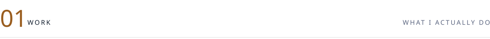
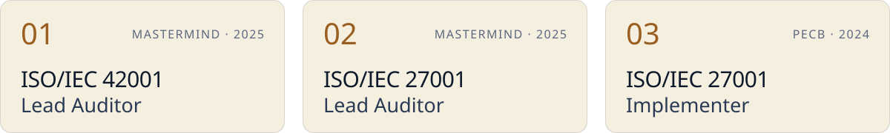
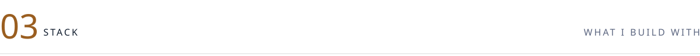
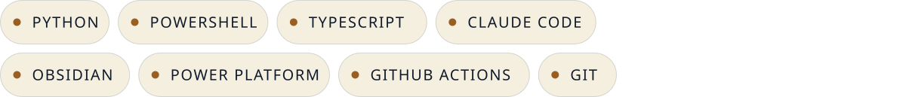
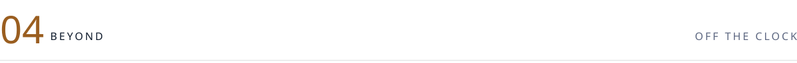
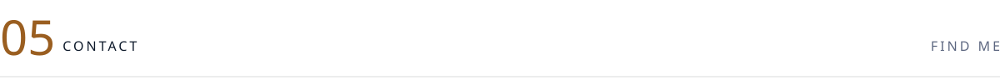
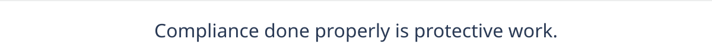

<picture>
  <source media="(prefers-color-scheme: dark)" srcset="assets/banner-dark.svg">
  
</picture>

 

I help organisations build compliance programmes that hold up under audit and still make
sense to the people who run them: ISO 27001, ISO 42001, SOC 2, and the governance layer
underneath AI adoption.

 

<picture>
  <source media="(prefers-color-scheme: dark)" srcset="assets/section-work-dark.svg">
  
</picture>

**Day job**
- ISO 27001, ISO 42001 and ISO 27017 implementation and audit
- SOC 2 readiness and evidence collection
- Regulation-led work: DORA, the EU AI Act, GDPR and POPIA
- AI governance and risk

**Building**
- Claude Code agents and plugins that take the repetitive parts out of GRC delivery
- A git-backed personal knowledge system (Obsidian + Claude Code) that runs my days
- Python and PowerShell tooling for compliance work
- Power Platform automation for compliance workflows

Most of it lives in private repositories, because it sits close to client work.

 

<picture>
  <source media="(prefers-color-scheme: dark)" srcset="assets/section-credentials-dark.svg">
  
</picture>

<picture>
  <source media="(prefers-color-scheme: dark)" srcset="assets/certs-dark.svg">
  
</picture>

 

<picture>
  <source media="(prefers-color-scheme: dark)" srcset="assets/section-stack-dark.svg">
  
</picture>

<picture>
  <source media="(prefers-color-scheme: dark)" srcset="assets/stack-dark.svg">
  
</picture>

 

<picture>
  <source media="(prefers-color-scheme: dark)" srcset="assets/section-beyond-dark.svg">
  
</picture>

- **InCyber Podcast**: co-host of a youth-driven cyber security show for people entering
  the field. Two seasons so far, currently on a break.
- **Children20 (C20)**: panels and policy work on children's online safety and privacy.
- **ASBN Future Leaders**: founding member of the Africa Scotland Business Network's
  Future Leaders cohort.

 

<picture>
  <source media="(prefers-color-scheme: dark)" srcset="assets/section-contact-dark.svg">
  
</picture>

  
  
  

 

<picture>
  <source media="(prefers-color-scheme: dark)" srcset="assets/footer-dark.svg">
  
</picture>
